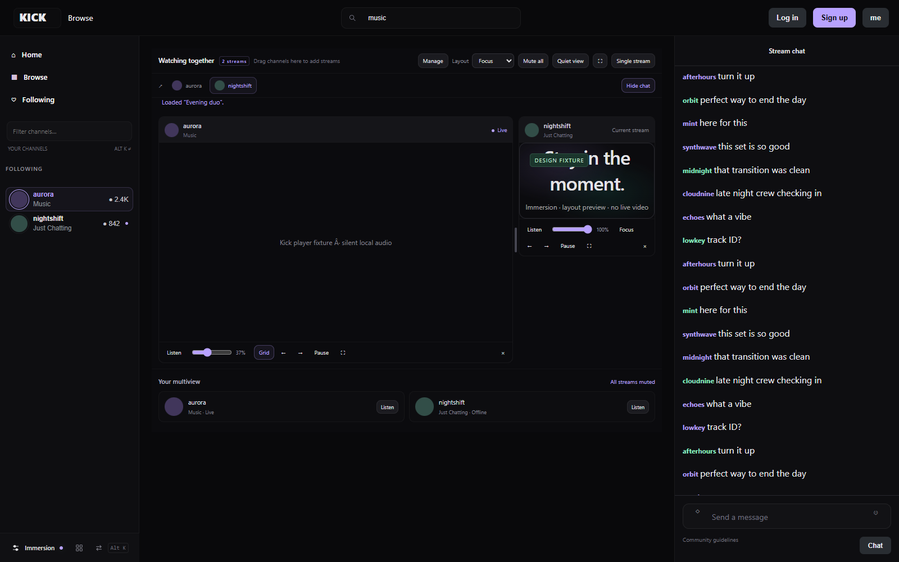

# Immersion

A sleek dark interface and built-in multistream workspace for Kick.

[Download for Firefox](https://github.com/jaredio/immersion/raw/refs/heads/main/dist/immersion-firefox.zip) · [Download for Chrome / Edge](https://github.com/jaredio/immersion/raw/refs/heads/main/dist/immersion-chrome.zip)



### Quick install

- **Firefox 142+:** download the Firefox ZIP, open `about:debugging#/runtime/this-firefox`, choose **Load Temporary Add-on**, and select the ZIP. Refresh Kick. This unsigned development install lasts until Firefox restarts.
- **Chrome / Edge:** download and extract the Chrome ZIP. Open `chrome://extensions` or `edge://extensions`, enable **Developer mode**, choose **Load unpacked**, and select the extracted folder. Refresh Kick.
- **Update:** reload the existing extension and refresh Kick to activate new scripts.

Open **Immersion** at the bottom of Kick's sidebar for settings. Use **Alt+K** to switch channels, or drag a sidebar channel onto a stream to start multiview.

### Build from source

Requires Node.js 22+ and Python 3:

```sh
git clone https://github.com/jaredio/immersion.git
cd immersion
npm ci
npm run build
npm test
```

Builds appear in `dist/firefox`, `dist/chrome`, and the ZIP files alongside them. For browser checks, install the test browsers with `npx playwright install chromium firefox`, then run `npm run test:browser`. See the verification notes below for test limitations.

A working Firefox and Chrome/Edge extension that gives Kick a charcoal, shadcn-inspired interface. Built against Kick's public HTML and client bundles on October 23, 2026. This is an independent extension, not affiliated with Kick or shadcn.

## Version 0.6 - Immersion

The extension is now **Immersion**, including its toolbar, settings, browser action, icons and packages. Its extension ID and storage keys remain compatible with the existing installation, so reloading the same add-on retains preferences and sessions. The workspace folder and internal identifiers retain their previous names for compatibility. Updated archives are `dist/immersion-firefox.zip` and `dist/immersion-chrome.zip`; the old archive filenames are kept as identical compatibility copies for temporary ZIP installations.

- **Resizable focus layout:** drag the divider between the featured stream and the other streams. Arrow keys adjust it by 1%, Shift+Arrow by 5%, Home/End reach the limits, and double-click resets it. **Manage > Featured size** offers a slider too. The split is saved in sessions and shared links. Narrow screens stack the layout and hide the divider.
- **Double-click a tile header** (outside the channel link) to focus that stream; repeat to return to the grid. The Focus button offers the same action. Players retain their existing frames.
- **Quick chat tabs** use channel photos and names. Clicking a tab reveals its chat; the original chat connection is reused when selected. Added chats still use one native popout frame: switching to a different added chat reloads that chat, so unread counts and scroll-position preservation are not claimed.
- **Quiet view** hides channel cards and secondary tile controls while keeping volume, Listen, playback, fullscreen, removal and chat controls available. This preference also saves with sessions.

To update, reload the existing temporary add-on in `about:debugging#/runtime/this-firefox` and refresh Kick. If installed from the old ZIP path, that compatibility ZIP now contains Immersion too. Avoid removing the add-on first if you want to retain its local settings.

## Version 0.5 — multiview controls and channel cards

Each tile now has volume, Listen, play/pause and fullscreen controls. Pausing retains the player instead of unloading it. Audio selection comes from explicit user actions; passive player status cannot select another source or trigger a mute-command feedback loop. Commands reject stale revisions and avoid redundant media setters. If Firefox blocks playback, click **Enable playback** inside the added player.

The original channel's title, biography and other single-channel sections are hidden while multiview is open. A compact **Your multiview** section replaces them with channel cards: available profile photos, names, categories, sidebar live/offline status and Listen controls. Missing information is left unknown; the extension does not fetch or invent biographies. Returning to **Single stream** restores the original sections.

Reload Immersion in `about:debugging#/runtime/this-firefox`, then refresh Kick. Compatibility ZIPs at the old paths also contain the update.

## Version 0.4 — inline multiview and input fixes

Drag a channel from Following / Your Channels or Recommended onto the main stream area. A temporary drop target appears above the videos so player iframes cannot swallow the drop. The first drop starts a fresh pair with the stream you are watching; further drops add to that page. Duplicate drops do not create duplicate players. Normal sidebar clicks still navigate normally.

Multiview now sits inside the stream page. The sidebar and navigation stay accessible; version 0.5 replaces the single-channel details with multiview cards. The current native player remains in its original DOM tree, positioned into its grid tile without being moved or replaced with another player. The original chat connection is reused for the current channel. Choosing another chat opens a native popout chat in the existing chat area; switching back restores the original chat. Additional players retain their frames through resizing, focus and reorder operations.

Session and manual-add controls are tucked under **Manage**. **Single stream** restores the original layout. Removing the last added stream does the same; if the only remaining stream is another channel, its normal channel page opens. Drag cancellation, route changes, style restoration and audio ownership have explicit cleanup. If Kick completely replaces its player during a narrow/mobile reflow, Immersion returns to the single-stream layout rather than retaining a broken native-player tile.

Original-message reply previews now use readable light text on a subtle dark box. Immersion also isolates keyboard events within its controls: T/M and other player shortcuts do not fire while typing in Alt+K, the sidebar filter or multiview fields. Arrow/Enter navigation, Escape and Alt+K continue to work inside the switcher. Outside Immersion controls, Kick's shortcuts are unchanged.

Reload the add-on in `about:debugging#/runtime/this-firefox`, then refresh existing Kick tabs. The page refresh is necessary for the early keyboard listener.

## Version 0.3 — switcher and multiview

- Fixed the Alt+K focus outline overlapping the ESC hint. The input shrinks within its row, and focus styling surrounds the entire search field.
- Removed the selected channel's left stripe. Live profile rings and sidebar live dots follow the selected accent.
- Alt+K now uses actual loaded profile pictures, categories and live/offline indicators. Status comes from Kick's native sidebar and updates with that sidebar; saved channels with no current data display **Unknown**, rather than a guessed status. Pins still work.
- Open **Multiview** using the grid icon in the sidebar dock, the Immersion settings footer, or **Add to Multi** in Alt+K. Add channel names or Kick URLs, up to six streams. Nothing loads until you open it.
- Grid, focus and columns layouts; focus/reorder controls; selectable native chat; fullscreen; one active audio source; mute all; per-stream pause/resume and remove. Layout changes preserve existing player frames. Closing unloads added embeds and restores the native layout. Explicitly paused playback remains paused.
- Save up to ten named sessions locally. The last workspace is restored when reopened. **Copy link** shares channels, layout, focus and chat selection with other Immersion users. Shared links replace the prior workspace. Audio always starts muted.

This is an independently implemented MultiKick-style workspace, not an embedded copy of MultiKick or a claim of complete feature parity. It uses [Kick's official player embeds](https://help.kick.com/en/articles/8010826-how-to-embed-your-kick-livestream) and [native popout chat](https://help.kick.com/en/articles/7978574-how-to-create-a-kick-chat-dock-in-obs). Playback availability, quality, advertisements, entitlements and chat sign-in remain under Kick's control. Quality controls remain inside each official player. Immersion adds volume and playback controls below each tile. Browser autoplay rules may require clicking Enable playback inside the frame. Multiple live streams use additional bandwidth and CPU/GPU resources; Remove unloads an added player, while Pause retains it.

## Version 0.2 — visual refinement

Immersion controls now live in a small dock at the bottom of the sidebar, leaving Kick's profile/settings area untouched. On narrow screens, a compact tab appears on the left edge. The native logo has a smaller monochrome treatment. Buttons, menus, native Radix tooltips and the chat profile card share quieter borders, typography and surfaces. The search field is wider on desktop and its icon, input and clear control use a single surface. The chat composer's identity, text and emote controls also share one border; the nested text-field box is gone.

To update an already loaded Firefox build, open `about:debugging#/runtime/this-firefox`, click **Reload** for Immersion, then refresh Kick. The old ZIP paths are also updated compatibility copies.

## Install

**Firefox 142 or newer**

1. Open `about:debugging#/runtime/this-firefox` in Firefox.
2. Choose **Load Temporary Add-on**.
3. Select `dist/firefox/manifest.json`, or select `dist/immersion-firefox.zip`.
4. Open or refresh Kick. Use **Immersion** at the bottom of the sidebar or the extension's browser-toolbar icon.

This is an unsigned development build. Firefox's temporary installation lasts until Firefox restarts. A persistent installation in ordinary Firefox requires Mozilla signing; this package has not been submitted or signed. [Mozilla installation instructions](https://extensionworkshop.com/documentation/develop/temporary-installation-in-firefox/).

**Chrome / Edge**

1. Open `chrome://extensions` or `edge://extensions`.
2. Turn on **Developer mode**, then choose **Load unpacked**.
3. Select the `dist/chrome` folder. Refresh existing Kick tabs.

[Chrome installation instructions](https://developer.chrome.com/docs/extensions/get-started/tutorial/hello-world#load-unpacked).

## What changes

- Charcoal surfaces, subtle borders, rounded controls, restrained mint accents and cleaner typography. Violet, ice blue and neutral accents are included.
- Restyled native following and recommended rows, compact density, channel filtering and an option to hide recommendations.
- **Alt+K** opens the channel switcher. **Ctrl+K / Cmd+K** also works when you are not typing. Arrow keys select a channel; Enter opens it. Pin channels from the switcher.
- Lean chat mode removes CSS animations/effects and converts native animated chat scroll calls into immediate scrolls. It preserves Kick's existing virtualized list, reading pause, replies, moderation and composer.
- Adjustable chat width and font size. Optional hiding of chat images preserves their boxes so native row measurements remain valid. Hiding images does not stop their downloads or guarantee that animated image decoding stops.
- A small navigation status indicator while Kick hands off a channel link. Existing channel links keep Kick's own navigation handler. Saved channels whose links are no longer present open through normal full-page navigation; these are labeled in the switcher.
- Settings apply immediately and are saved locally. The master switch restores the native theme without a reload. The small settings control stays accessible.

## Performance boundaries

This does not replace Kick's video player, change stream quality, bypass stream startup, intercept API traffic, disable subscriptions, or rewrite chat delivery. There is no measured claim of lower video startup latency or higher frame rate. Instant scrolling and reduced effects address browser-side visual overhead; player/CDN buffering remains under Kick's control. Route feedback measures no playback timing.

The script ignores message-list mutation bursts and does not clone or trim React-owned chat messages. It uses a debounced document observer for sidebar/navigation changes, plus temporary route polling only after a channel click. No continuous document scanning loop runs.

## Privacy

Only the `storage` API permission and content scripts scoped to Kick's canonical/www pages and `https://player.kick.com/*` are used. Preferences, pins and multiview sessions remain in extension-local storage. Multiview loads only Kick's official player and chat URLs for the channels you select. There is no analytics, remote extension code, custom backend or third-party font request. A narrowly scoped helper controls volume and playback only in Immersion-created player frames, checks the parent window and exact origin, and reports playback/mute/volume status and playback errors. Native popout chat receives theme/preferences without another toolbar. No cookies, credentials or chat transcripts are stored by the extension. [Firefox data declaration](https://extensionworkshop.com/documentation/develop/firefox-builtin-data-consent/).

## Verification

`artifacts/browser-results.json` records the browser checks. Screenshots named `chromium-*` and `firefox-*` use a clearly labeled synthetic layout fixture, not live streams.

- Version 0.6 checks cover pointer and keyboard resizing, double-click focus, player survival during layout changes, Quiet view, chat-tab selection and custom split restoration from saved sessions. Both browser suites continue exercising the audio feedback regression checks. Firefox uses the extension API shim described below. New screenshots are `artifacts/*-immersion-multiview-v6.png`.
- A live version 0.6 check verified divider resizing to 59%, Quiet view, two photo chat tabs, native player/chat preservation and zero native-player placement error. Screenshots and metrics: `artifacts/live-immersion-multiview-v6.png` and `artifacts/live-inline-validation-v6.json`. Playback decoding was disabled, so this is a layout/integration check.
- Unit checks cover settings validation, unsafe/non-channel URLs, reversible chat-only scroll changes, and package permissions/assets.
- Chromium tests load the actual unpacked extension, including its popup, native content-script execution and extension storage. Checks cover filtering, native-link dispatch, pinning, keyboard behavior, 500 appended chat rows, disable/reset, settings persistence, popup-to-tab updates and layouts from 390 to 1600 pixels.
- Version 0.2 checks additionally exercise native account-menu access, search typing, a single composer border, tooltip colors, and preserved reply/mute handlers inside a synthetic native-profile-card structure. Screenshots ending in `-v2.png` show these fixtures; they do not prove authenticated Kick actions.
- Version 0.3 tests cover photo/status rendering, ESC geometry, theme-colored live rings, single-source audio commands, iframe survival during focus/reorder, chat selection, named sessions, a six-stream limit, and removing every iframe on close. Mock player frames contain no live video. Unit checks reject unsafe channel/session inputs and untrusted audio messages.
- Version 0.5 tests use real HTML media playback with a local silent WAV in test frames. Checks cover added-player pause/play, volume, frame preservation, repeated Listen switches, passive volume-event bursts without command feedback, compact channel cards, and hiding/restoring native channel information. Unit tests also cover stale commands, a queued Play superseded by Pause before video creation, and redundant setter prevention. This does not verify audible live audio or reproduce every Firefox autoplay configuration. Screenshots ending in `-inline-multiview-v4.png` now show the updated fixture layout.
- A live version 0.5 UI check verified two channel cards, two volume sliders, two playback buttons, hidden original details, preserved native video/chat and zero measured native-player placement error. See `artifacts/live-inline-validation-v5.json` and `artifacts/live-inline-multiview-v5.png`. Live decoding was blocked for this inspection.
- Version 0.4 tests perform browser drag gestures from both sidebar sections, duplicate/canceled drops, native video identity/geometry preservation, native chat reuse, restoring the single-stream layout, and inline resizing from 390 to 1600px. They verify dark reply text contrast and simulate capture-phase T/M shortcuts to check both input isolation and normal shortcuts outside Immersion. Firefox engine tests still use a mocked extension API, while Chromium loads the actual unpacked extension.
- A live Kick drag check verified two inline tiles with only one additional iframe, the same native video and chat elements, and zero measured placement error at desktop size. It also checked 1280px and 1024px layouts. Playback decoding was disabled for this inspection; no uninterrupted-playback or latency benchmark is claimed. See `artifacts/live-inline-validation-v4.json` and `artifacts/live-inline-multiview-v4.png`.
- A live anonymous Chromium check on October 24 loaded two actual official player frames plus native popout chat within the workspace. Live playback decoding was intentionally blocked during this UI inspection; this proves embed/UI integration, not sustained playback performance. `artifacts/live-switcher-v3.png` and `artifacts/live-multiview-v3.png` show the live site.
- Firefox engine tests exercise the same DOM/CSS behavior using an explicitly mocked extension API. They do not prove a real installed/signed Firefox add-on session. Mozilla's `web-ext lint` separately validates the actual Firefox package.
- A live anonymous Kick check verified the native sidebar, channel chat, in-page settings, channel handoff, theme recovery after hydration and a 390-pixel layout. Kick's React hydration exception also occurred in a baseline browser without the extension.
- Logged-in following lists, sending chat, moderation actions and extension conflicts were not exercised. Their native controls are preserved, but need testing in an authenticated session. Kick markup can change; update selectors in `extension/theme.css` and `extension/content.js` if detection stops working.

## Development

Node 22+, Python 3, and Playwright for browser tests:

```powershell
npm install
npx playwright install chromium firefox
npm run build
npm test
npm run test:browser
npx web-ext lint --source-dir dist/firefox
```

The extension itself has no runtime dependencies. `npm run build` copies the source, creates separate manifests and packages ZIPs using Python's standard library. Browser tools accept `KR_CHROMIUM` and `KR_FIREFOX` executable overrides. `tools/inspect-live.mjs` uses a fresh project-local test profile, never your personal browser profile.

Source lives in `extension/`; browser-ready folders and ZIPs live in `dist/`. The surrounding workspace's earlier projects were left intact.
