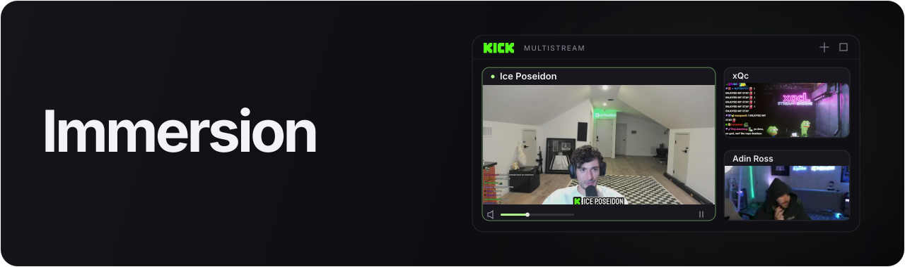

<p align="center">
  
</p>

<p align="center">
  A more considered way to watch <a href="https://kick.com">Kick</a>.
  <br>
  Available for Firefox, Chrome, and Edge.
</p>

<p align="center">
  <a href="https://github.com/jaredio/immersion/raw/refs/heads/main/dist/immersion-firefox.zip"><strong>Download for Firefox</strong></a>
  &nbsp; &middot; &nbsp;
  <a href="https://github.com/jaredio/immersion/raw/refs/heads/main/dist/immersion-chrome.zip"><strong>Download for Chrome / Edge</strong></a>
  &nbsp; &middot; &nbsp;
  <a href="https://github.com/jaredio/immersion/issues">Feedback &amp; issues</a>
</p>

---

Immersion gives Kick a cleaner look and a more flexible way to watch. Channel details, goals, chat notices, polls, and predictions share a consistent dark design, with accents you can make your own.

Bring several streams into one page, arrange the layout, and save your setup for next time. Focus a stream to switch its chat and audio, with your chosen volume carried across. Turn on Mix audio when you want to hear more than one.

Search for channels, clips, and recordings, then drag them into your viewing space. Kick's native players, chat, and channel controls stay part of the experience.

## Get started

<details>
<summary><strong>Firefox</strong></summary>

1. [Download the Firefox package](https://github.com/jaredio/immersion/raw/refs/heads/main/dist/immersion-firefox.zip).
2. Open `about:debugging#/runtime/this-firefox`.
3. Choose **Load Temporary Add-on** and select the downloaded ZIP.
4. Open or refresh Kick.

Requires Firefox 142 or newer. This development install lasts until Firefox restarts.

</details>

<details>
<summary><strong>Chrome / Edge</strong></summary>

1. [Download the Chrome / Edge package](https://github.com/jaredio/immersion/raw/refs/heads/main/dist/immersion-chrome.zip) and extract it.
2. Open `chrome://extensions` or `edge://extensions`.
3. Enable **Developer mode**, choose **Load unpacked**, and select the extracted folder.
4. Open or refresh Kick.

</details>

You'll find **Immersion** at the bottom of Kick's sidebar. Make it yours from there. To apply an update, reload the extension and refresh Kick.

## Made to be yours

Your preferences and saved viewing sessions stay in your browser. Immersion has no analytics or custom backend.

Found something that feels off? [Open an issue](https://github.com/jaredio/immersion/issues) with your browser, what happened, and a screenshot if it helps. Kick changes often; real-world feedback keeps Immersion improving.

<details>
<summary><strong>Working on the project</strong></summary>

Requires Node.js 22+ and Python 3.

```sh
npm ci
npm run build
npm test
```

Source lives in `extension/`. Browser builds and installable ZIPs are written to `dist/`. Additional browser checks are listed in [`package.json`](package.json).

</details>

---

<p align="center"><sub>An independent project. Not affiliated with or endorsed by Kick.</sub></p>
